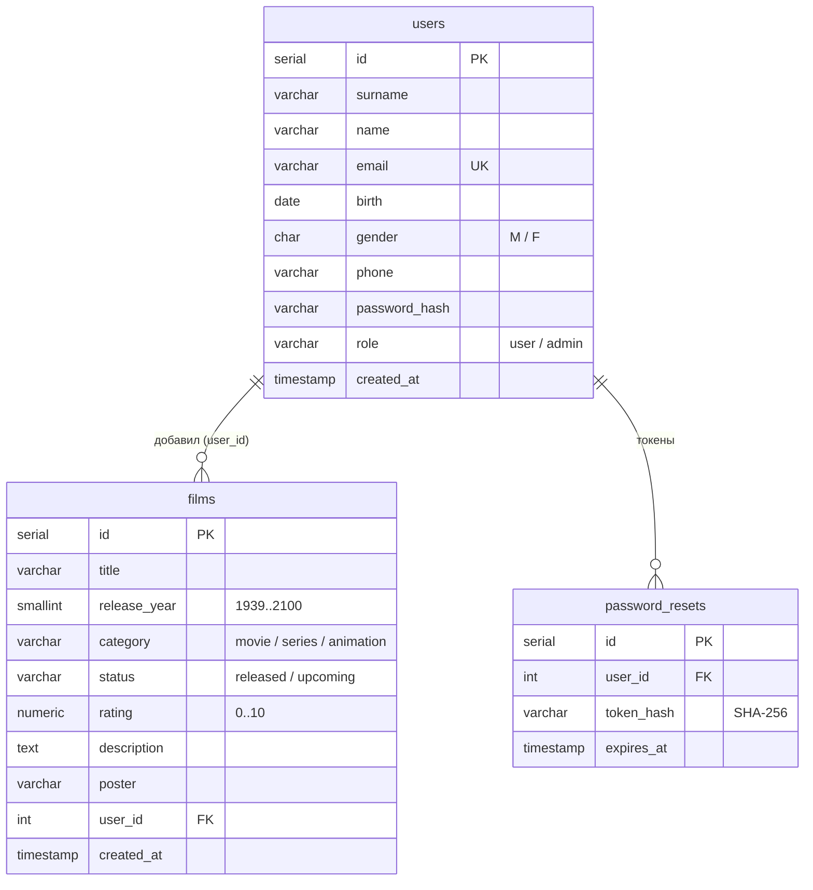

# -PHP
Marvel-site

# Marvel — каталог фильмов (PHP + PostgreSQL)

Индивидуальная работа по разработке веб-приложения с серверной частью. Приложение — каталог фильмов, сериалов и мультфильмов вселенной Marvel: публичные страницы с данными из БД, регистрация и вход, поиск, форма добавления фильма, восстановление пароля и панель администратора.

Стек: **PHP 8.1+** (без фреймворков, архитектура MVC), **PostgreSQL 16** в **Docker**, HTML5 / CSS / JavaScript.

## Содержание

1. [Запуск проекта](#запуск-проекта)
2. [Описание работы](#описание-работы)
3. [Документация проекта](#документация-проекта)
   - [Структура проекта](#структура-проекта)
   - [Функциональные возможности](#функциональные-возможности)
   - [Сценарии взаимодействия пользователей](#сценарии-взаимодействия-пользователей)
   - [Структура базы данных](#структура-базы-данных)
   - [Безопасность](#безопасность)
4. [Примеры использования](#примеры-использования)
5. [Ответы на контрольные вопросы](#ответы-на-контрольные-вопросы)
6. [Список использованных источников](#список-использованных-источников)
7. [Другие важные аспекты](#другие-важные-аспекты)

## Запуск проекта

Требуется: **Docker Desktop**, **PHP 8.1+** с расширениями `pdo_pgsql` и `pgsql`.

```bash
# 1. Клонировать репозиторий
git clone https://github.com/<ваш-логин>/marvel.git
cd marvel

# 2. Запустить базу данных (PostgreSQL в Docker, схема и тестовые данные создаются автоматически)
docker compose up -d

# 3. Запустить сайт встроенным сервером PHP
php -S localhost:8000 -t public
```

Откройте <http://localhost:8000>.

**Администратор по умолчанию:** `admin@marvel.local` / `Admin123!`

Параметры подключения к БД лежат в `app/config.php` (хост `127.0.0.1`, порт `5433`, база `marvel`, пользователь `marvel`). Порт `5433` выбран, чтобы не конфликтовать с локально установленным PostgreSQL.

**Если сайт пишет `could not find driver`** — в `php.ini` раскомментируйте `extension=pdo_pgsql` и `extension=pgsql` (путь к файлу: `php --ini`), перезапустите `php -S`. Проверка: `php -m` должен показывать `pdo_pgsql`.

**Полный сброс базы** (заново выполнится `db/init.sql`):

```bash
docker compose down -v
docker compose up -d
```

## Описание работы

**Задача.** Разработать веб-приложение средней сложности с функционалом на стороне сервера: аутентификация, публичный раздел с динамическим содержимым, две формы (создание ресурса и поиск), защищённый раздел с ролью администратора, защита от типовых атак, модульная архитектура.

**Тема.** Каталог фильмов Marvel. Основной ресурс — запись о фильме (название, год, категория, статус, рейтинг, описание, ссылка на постер).

**Основные этапы:**

1. Проектирование БД (пользователи, фильмы, токены восстановления пароля).
2. Каркас приложения: единая точка входа, маршрутизация, подключение к БД, сессии.
3. Аутентификация: регистрация, вход, выход, хеширование паролей.
4. Публичный раздел: главная (3 блока из БД), список фильмов, форма поиска.
5. Форма создания ресурса с проверкой на клиенте и на сервере.
6. Панель администратора: управление фильмами и пользователями, создание администраторов.
7. Защита: XSS, SQL-инъекции, CSRF, управление сессиями, CAPTCHA.
8. Дополнительное задание: восстановление пароля по ссылке.
9. Контейнеризация БД, документация.

## Документация проекта

### Структура проекта

```
docker-compose.yml     PostgreSQL в Docker
db/init.sql            таблицы, тестовые данные, администратор по умолчанию
public/                корень веб-сервера (то, что видит браузер)
  index.php            единая точка входа и таблица маршрутов
  css/style.css        стили
  js/validate.js       клиентская проверка форм
  img/                 изображения
app/
  config.php           настройки (БД, debug, captcha, почта)
  core.php             БД, сессии, XSS/CSRF-защита, авторизация, шаблоны, CAPTCHA, почта
  models/              UserModel, FilmModel — работа с БД (только подготовленные запросы)
  controllers/         HomeController, AuthController, FilmController, AdminController
  views/               HTML-шаблоны (layout, partials, admin)
storage/mail.log       «отправленные» письма (восстановление пароля)
```

**Архитектура MVC.** Запрос попадает в `public/index.php` (front controller), который по параметру `page` выбирает контроллер и метод из таблицы маршрутов. Контроллер проверяет права, получает данные из модели и передаёт их в представление через `render()`. Модели — единственное место, где выполняются SQL-запросы.

Таблица маршрутов:

| `?page=` | Контроллер::метод | Доступ |
|---|---|---|
| `home` | HomeController::index | все |
| `history` | HomeController::history | все |
| `films` | FilmController::index | все (список + поиск) |
| `register`, `login`, `forgot`, `reset` | AuthController | гости |
| `logout` | AuthController::logout | любой |
| `film_add` | FilmController::create | вошедшие пользователи |
| `admin`, `admin_films`, `admin_film_edit`, `admin_film_delete` | AdminController | администратор |
| `admin_users`, `admin_user_add`, `admin_user_role`, `admin_user_delete` | AdminController | администратор |

### Функциональные возможности

**Гость (без входа):**

- главная страница с тремя динамическими блоками из БД: «Top Rated Projects» (лучшие по рейтингу), «Upcoming Marvel Releases» (ожидаемые релизы), «Recently Added» (последние добавленные);
- страница «History» (статический текст);
- страница «Films» — таблица всех фильмов и **форма поиска** по названию, категории, статусу и диапазону годов (критерии комбинируются);
- регистрация, вход, восстановление пароля.

**Авторизованный пользователь:**

- добавление фильма через форму из 7 полей (текст, число, выпадающий список, радиокнопки, число, текстовая область, URL);
- выход из системы.

**Администратор (6 функций):**

1. статистика (число пользователей, администраторов, фильмов);
2. просмотр всех фильмов с автором записи;
3. редактирование фильма;
4. удаление фильма;
5. просмотр пользователей, смена роли (`user` ⇄ `admin`) и удаление пользователя (свою роль менять и себя удалять нельзя);
6. **создание новых учётных записей с ролью администратора**.

Добавление фильма администратор выполняет той же формой, что и пользователь.

**Дополнительное задание — восстановление пароля.** Пользователь вводит e-mail; если адрес зарегистрирован, создаётся одноразовый токен (в БД хранится только его SHA-256 хеш, срок действия 1 час), ссылка записывается в `storage/mail.log` (и отправляется через `mail()` при `mail_real => true`). Ответ одинаков для существующих и несуществующих адресов — это не позволяет узнать, кто зарегистрирован.

### Сценарии взаимодействия пользователей

**Сценарий 1. Регистрация и вход.**
1. Гость открывает «Register», заполняет поля (фамилия, имя, e-mail, дата рождения, пол, телефон, пароль, повтор пароля, CAPTCHA).
2. Браузер проверяет поля (HTML5 + `validate.js`), сервер перепроверяет (`UserModel::validate`). При ошибке форма показывается снова с сообщением под каждым полем и сохранёнными значениями.
3. При успехе пароль сохраняется как `password_hash`, пользователь перенаправляется на «Log in».
4. После входа создаётся новый идентификатор сессии (`session_regenerate_id`), в сессии сохраняется `user_id`.

**Сценарий 2. Поиск фильма.** Гость открывает «Films», вводит часть названия (`Iron`), выбирает категорию или статус, задаёт годы и нажимает «Search». Выводится количество найденных фильмов и таблица; если ничего нет — подсказка «Nothing found».

**Сценарий 3. Добавление фильма.** Вошедший пользователь открывает «Add film», заполняет форму. Некорректные данные (например, год 1800 или рейтинг 11) возвращаются с сообщением об ошибке; корректные — сохраняются с привязкой к автору (`films.user_id`).

**Сценарий 4. Восстановление пароля.** «Forgot your password?» → ввод e-mail → ссылка из `storage/mail.log` (в режиме `debug` показывается и на странице) → ввод нового пароля → вход с новым паролем. Старые токены удаляются.

**Сценарий 5. Работа администратора.** Вход под `admin@marvel.local` → «Admin panel» → управление фильмами (Edit / Delete с подтверждением) → управление пользователями (смена роли, удаление) → «Create administrator».

**Сценарий 6. Попытка обхода доступа.** Гость открывает `?page=film_add` — перенаправление на вход с сообщением; обычный пользователь открывает `?page=admin` — страница ошибки 403; неизвестный `page` — ошибка 404.

### Структура базы данных



| Таблица | Назначение | Особенности |
|---|---|---|
| `users` | учётные записи | `email` уникален; `role` ограничен значениями `user`/`admin`; пароль — только хеш |
| `films` | основной ресурс | `CHECK` на год, категорию, статус и рейтинг; `user_id` → `users`, при удалении автора `ON DELETE SET NULL` |
| `password_resets` | токены восстановления | хранится хеш токена и срок действия; `ON DELETE CASCADE` при удалении пользователя |

Схема и начальные данные (11 фильмов, администратор) — в [`db/init.sql`](db/init.sql).

### Безопасность

| Угроза / требование | Меры |
|---|---|
| Хранение паролей | `password_hash()` (bcrypt, `PASSWORD_DEFAULT`), проверка `password_verify()`; пароль 8–72 символа, буква и цифра |
| SQL-инъекции | PDO, подготовленные запросы, `ATTR_EMULATE_PREPARES = false`; в поиске экранируются `%` и `_` |
| XSS | весь вывод проходит через `e()` (`htmlspecialchars`); входные данные валидируются |
| CSRF | токен в сессии, скрытое поле во всех POST-формах, проверка `hash_equals` |
| Сессии | cookie `HttpOnly`, `SameSite=Lax`; `session_regenerate_id` при входе и выходе; роль берётся из БД на каждый запрос |
| Разграничение доступа | `require_login()` и `require_admin()` в начале каждого защищённого метода |
| Перебор / боты | математическая CAPTCHA на входе и регистрации (отключается `captcha => false`) |
| Восстановление пароля | токен 256 бит, в БД только хеш, срок 1 час, одинаковый ответ для любых адресов |
| Заголовки | `X-Content-Type-Options: nosniff`, `X-Frame-Options: DENY` |

## Примеры использования

**Подготовленный запрос поиска с экранированием шаблона** (`app/models/FilmModel.php`):

```php
if (($f['q'] ?? '') !== '') {
    $where[] = 'title ILIKE :q';
    $params[':q'] = '%' . addcslashes(mb_substr($f['q'], 0, 100), '%_\\') . '%';
}
if (isset(self::CATEGORIES[$f['category'] ?? ''])) {
    $where[] = 'category = :category';
    $params[':category'] = $f['category'];
}
```

**Хеширование пароля и вход** (`UserModel.php`, `AuthController.php`):

```php
':hash' => password_hash($d['password'], PASSWORD_DEFAULT),
// ...
if ($user && password_verify(raw($_POST, 'password'), $user['password_hash'])) {
    session_regenerate_id(true);          // защита от фиксации сессии
    $_SESSION['user_id'] = (int)$user['id'];
}
```

**Защита маршрутов** (`core.php`):

```php
function require_admin(): void
{
    require_login();
    if (current_user()['role'] !== 'admin') {
        http_response_code(403);
        render('error', ['title' => 'Forbidden', 'code' => 403,
                         'message' => 'Only administrators can open this page.']);
        exit;
    }
}
```

**Серверная валидация формы фильма** (`FilmModel::validate`):

```php
$year = filter_var($d['release_year'], FILTER_VALIDATE_INT);
if ($year === false || $year < 1939 || $year > 2100) {
    $errors['release_year'] = 'Year must be a number between 1939 and 2100.';
}
```

**Клиентская проверка** (`public/js/validate.js`): пароль должен содержать букву и цифру, повтор должен совпадать, для полей с `pattern` показываются понятные сообщения из атрибута `data-msg`.

**Поиск через адресную строку:**

```
http://localhost:8000/index.php?page=films&q=avengers&status=released&year_from=2012
```

## Ответы на контрольные вопросы

**1. Что такое архитектура MVC и какие у неё преимущества?**
MVC разделяет приложение на модель (данные и работа с БД), представление (HTML-шаблоны) и контроллер (обработка запроса, проверка прав, связь модели с представлением). Код легче читать, тестировать и расширять: смена оформления не затрагивает SQL, а смена схемы БД — шаблоны. В проекте: `app/models`, `app/views`, `app/controllers`.

**2. Как правильно хранить пароли? Чем хеширование отличается от шифрования?**
Шифрование обратимо (есть ключ), хеширование — нет. Пароль хранят только как хеш медленной функции с «солью» (`password_hash` — bcrypt), а проверяют через `password_verify`. Тогда утечка БД не раскрывает пароли напрямую.

**3. Что такое SQL-инъекция и как от неё защититься?**
Это внедрение SQL-кода через пользовательский ввод, который склеивается с запросом. Защита — подготовленные запросы с параметрами (PDO), whitelist допустимых значений и валидация. В проекте все запросы с пользовательскими данными подготовленные.

**4. Что такое XSS и как его предотвратить?**
Внедрение JavaScript в страницу через непроверенный ввод. Защита — экранирование всего вывода (`htmlspecialchars`, функция `e()`), валидация ввода, заголовки безопасности.

**5. Что такое CSRF и как защищаются формы?**
Атака, при которой чужой сайт отправляет от имени вошедшего пользователя запрос к вашему. Защита — случайный токен в сессии и в скрытом поле формы, проверяемый на сервере (`csrf_check`), плюс `SameSite` у cookie.

**6. Как работают сессии и зачем `session_regenerate_id`?**
Сервер хранит данные сессии, а браузеру отдаёт cookie с идентификатором. После входа идентификатор меняют, чтобы злоумышленник, заранее подсунувший свой идентификатор (фиксация сессии), не получил доступ к аккаунту.

**7. Зачем проверять данные и на клиенте, и на сервере?**
Клиентская проверка удобна пользователю (мгновенные подсказки), но её можно обойти. Серверная — обязательна для безопасности и целостности данных. В проекте: HTML5-атрибуты и `validate.js` + `FilmModel::validate`, `UserModel::validate`.

**8. Чем отличаются методы GET и POST? Где какой используется?**
GET передаёт параметры в адресе и не должен менять данные — используется для страниц и поиска. POST передаёт данные в теле запроса — используется для форм, изменяющих состояние (регистрация, добавление, удаление), с CSRF-токеном.

**9. Как устроено восстановление пароля?**
Генерируется случайный токен, в БД хранится его хеш и срок действия, пользователю уходит ссылка с токеном. По ссылке пользователь задаёт новый пароль, после чего токены удаляются. Одинаковый ответ для любых адресов не раскрывает список пользователей.

**10. Как реализовано разграничение ролей?**
В таблице `users` есть поле `role`. Контроллеры вызывают `require_login()`/`require_admin()`; роль читается из БД при каждом запросе, поэтому её смена действует сразу. Администратор не может сменить свою роль и удалить себя.

**11. Что такое front controller и зачем он нужен?**
Единая точка входа (`public/index.php`), через которую идут все запросы. Здесь подключаются общие настройки, сессии, защитные заголовки и выбирается контроллер, что исключает дублирование кода и прямой доступ к файлам приложения (папка `app` вне `public`).

**12. Зачем нужен Docker в проекте?**
Контейнер даёт одинаковую среду PostgreSQL на любом компьютере: версия, учётные данные и схема БД задаются в `docker-compose.yml` и `db/init.sql`, запуск — одной командой.

## Список использованных источников

1. PHP Manual. — URL: <https://www.php.net/manual/ru/> (дата обращения: 25.11.2026).
2. PHP Manual: `password_hash`. — URL: <https://www.php.net/manual/ru/function.password-hash.php>.
3. PHP Manual: PDO. — URL: <https://www.php.net/manual/ru/book.pdo.php>.
4. PostgreSQL 16 Documentation. — URL: <https://www.postgresql.org/docs/16/>.
5. OWASP Cheat Sheet Series (Password Storage, SQL Injection Prevention, XSS Prevention, CSRF Prevention, Session Management). — URL: <https://cheatsheetseries.owasp.org/>.
6. OWASP Top Ten. — URL: <https://owasp.org/www-project-top-ten/>.
7. Docker Documentation: Docker Compose. — URL: <https://docs.docker.com/compose/>.
8. MDN Web Docs: Валидация форм на стороне клиента. — URL: <https://developer.mozilla.org/ru/docs/Learn/Forms/Form_validation>.

## Другие важные аспекты

- **Режим разработки.** В `app/config.php` стоит `'debug' => true`: на странице показываются подробные ошибки БД и ссылка сброса пароля. Для публикации поставьте `false`.
- **Почта.** Реальная отправка не настроена: письма пишутся в `storage/mail.log` (файл в `.gitignore`). Для отправки включите `'mail_real' => true` и настройте SMTP в PHP.
- **Постеры** подгружаются по внешним ссылкам; если ссылка недоступна, изображение не показывается.
- **Учётные данные** БД и администратора в репозитории — учебные; в реальной системе их выносят в переменные окружения и меняют.
- **Возможные улучшения:** ограничение числа попыток входа, пагинация списка фильмов, загрузка постеров на сервер, тесты.
